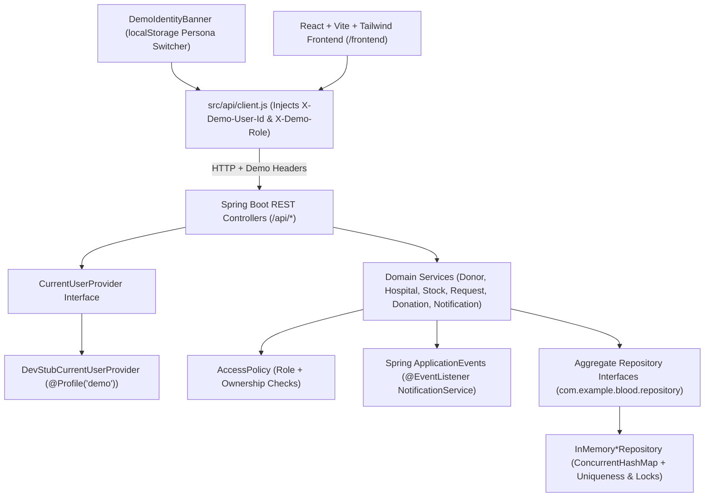

# 🩸 Rakt Sanchar — Zero-Cost Blood Donation, Stock & Emergency Matching Platform

[](#)
[](#)
[](#)
[](#)

> [!WARNING]
> **Interim Demo Notice — Authentication & Database Deferred**  
> This repository implements the **Zero-Cost Build Plan (Revision 2)** where **Authentication** and **Database Persistence** are intentionally deferred to the repository owner using two clean architectural placeholders:
> 1. **Stub Identity Provider (`DevStubCurrentUserProvider`, `@Profile("demo")`)**: Reads `X-Demo-User-Id` and `X-Demo-Role` from HTTP headers (`DONOR`, `HOSPITAL`, `ADMIN`). Outside the `demo` profile, `DisabledCurrentUserProvider` rejects protected endpoints with `401 IDENTITY_REQUIRED`.
> 2. **In-Memory Repositories (`InMemory*Repository`)**: Thread-safe `ConcurrentHashMap` implementations behind aggregate repository interfaces (`UserRepository`, `DonorProfileRepository`, `HospitalRepository`, `BloodStockRepository`, `BloodRequestRepository`, `DonationRepository`, `NotificationRepository`). All data is seeded on startup via `DemoDataSeeder` (`@Profile("demo")`) and resets on restart.
>
> **Do NOT expose the `demo` profile publicly or enter real personal/medical data.** See [`docs/DEFERRED_WORK.md`](docs/DEFERRED_WORK.md) for the complete handoff guide on replacing both placeholders.

---

## 📌 Table of Contents

1. [What Rakt Sanchar Solves](#-what-rakt-sanchar-solves)
2. [Zero-Cost Architecture & Placeholders](#-zero-cost-architecture--placeholders)
3. [Quick Start (Local Demo Mode)](#-quick-start-local-demo-mode)
4. [Seeded Demo Personas](#-seeded-demo-personas)
5. [End-to-End 5-Minute Demo Walkthrough](#-end-to-end-5-minute-demo-walkthrough)
6. [Core Business Rules (Interview Reference)](#-core-business-rules-interview-reference)
7. [REST API Overview & Swagger UI](#-rest-api-overview--swagger-ui)
8. [Testing & Verification](#-testing--verification)
9. [Deferred Work Handover (Auth & Database)](#-deferred-work-handover-auth--database)

---

## 🎯 What Rakt Sanchar Solves

During medical emergencies, patients and families struggle to locate verified blood stock or eligible, compatible donors nearby. **Rakt Sanchar** connects:
- **Patients & Requesters**: Search live blood stock across verified hospitals, post urgent blood requests (`CRITICAL`, `URGENT`, `NORMAL`), and automatically match with compatible, eligible donors nearby.
- **Blood Donors**: Track their 90-day cooling-off eligibility countdown, toggle availability, respond (`ACCEPT` / `DECLINE`) to urgent blood requests, claim or view verified donations, and earn milestone badges (`FIRST_DROP`, `LIFESAVER_5`, `CENTURION_10`, `RARE_GROUP_HERO`, `REGULAR_DONOR`).
- **Hospitals & Blood Banks**: Register their facility, manage live unit counts and low-stock alert thresholds across all 8 ABO/Rh blood groups, verify donor donation claims, and record direct in-hospital donations.
- **System Administrators**: Review hospital license registrations and approve (`VERIFIED`) or reject (`REJECTED`) hospitals before their stock becomes publicly visible.
- **Bilingual Accessibility**: Instant English (`en`) and Hindi (`hi`) UI and localized in-app notifications.

---

## 🏗️ Zero-Cost Architecture & Placeholders



### Why Business Logic Does Not Change Later
- **Services never touch HTTP headers or tokens**: Every protected controller resolves `CurrentUser` via `CurrentUserProvider` and passes `CurrentUser` into service methods. `AccessPolicy` validates roles (`DONOR`, `HOSPITAL`, `ADMIN`) and resource ownership against `CurrentUser`.
- **Services never touch persistence annotations or database queries**: Domain models (`User`, `DonorProfile`, `Hospital`, `BloodStock`, `BloodRequest`, `Donation`, `Notification`) are clean POJOs. Services call only repository interfaces.

---

## 🚀 Quick Start (Local Demo Mode)

### Prerequisites
- **Java 17+** (Maven Wrapper `./mvnw` is included)
- **Node.js 20+** and `npm`

### 1. Start the Spring Boot Backend (`demo` profile)
```bash
./mvnw spring-boot:run -Dspring-boot.run.profiles=demo
```
- Backend runs at: `http://localhost:8080`
- Interactive OpenAPI / Swagger UI: `http://localhost:8080/swagger-ui.html`
- OpenAPI JSON spec: `http://localhost:8080/v3/api-docs`

### 2. Start the React + Vite Frontend
In a second terminal:
```bash
cd frontend
npm install
npm run dev
```
- Frontend runs at: `http://localhost:5173` (proxies `/api` to `http://localhost:8080`)
- Legacy static UI remains accessible at: `http://localhost:8080/legacy/index.html`

---

## 👥 Seeded Demo Personas

Use the **Demo Identity Banner** at the top of the UI (or pass `X-Demo-User-Id` and `X-Demo-Role` headers in HTTP requests) to switch between personas instantly:

| Persona Key | `X-Demo-User-Id` | `X-Demo-Role` | City | Description |
| :--- | :--- | :--- | :--- | :--- |
| **Guest** | *(omitted)* | *(omitted)* | — | Public visitor browsing blood stock, hospitals & open requests |
| **Priya Sharma** | `donor-1` | `DONOR` | Mumbai | **O+** donor, eligible now (last donated 120 days ago), earned `FIRST_DROP` |
| **Rohan Verma** | `donor-2` | `DONOR` | Delhi | **A+** donor, in 90-day cooling-off window (donated 45 days ago), Hindi (`hi`) preference |
| **Ananya Nair** | `donor-3` | `DONOR` | Bengaluru | **O-** universal donor, eligible now, earned `FIRST_DROP` + `RARE_GROUP_HERO` |
| **Siddharth Kulkarni** | `donor-4` | `DONOR` | Hyderabad | **B+** donor, eligible now |
| **Fatima Sheikh** | `donor-5` | `DONOR` | Pune | **AB+** first-time donor, eligible now |
| **City Care Hospital** | `hospital-1` | `HOSPITAL` | Mumbai | **VERIFIED** hospital with seeded blood stock (including low-stock **O-** alert) |
| **Janata Seva Hospital** | `hospital-2` | `HOSPITAL` | Delhi | **PENDING** hospital awaiting Admin verification |
| **Kaveri Heart & Trauma** | `hospital-3` | `HOSPITAL` | Bengaluru | **VERIFIED** hospital with blood stock across groups |
| **Aarav Mehta** | `admin-1` | `ADMIN` | Mumbai | System administrator who approves or rejects hospitals |

---

## 🎬 End-to-End 5-Minute Demo Walkthrough

1. **Public Discovery & Privacy Masking**:
   - Select **Guest (Public Visitor)** in the top banner.
   - Visit **Blood Stock** (`/stock`) and filter by `O+` or `Mumbai`. Only `VERIFIED` hospitals (`City Care Hospital`, `Kaveri Heart & Trauma`) appear; unverified `Janata Seva Hospital` is excluded.
   - Visit **Blood Requests** (`/requests`) to see open requests.
2. **Donor Eligibility, Matching & Response**:
   - Switch persona to **Priya Sharma (`donor-1`, `DONOR`)** and open **Donor Dashboard** (`/donor/dashboard`).
   - Observe the green **Eligible to Donate Now** status, `First Drop` badge, and open requests in Mumbai.
   - Switch to **Rohan Verma (`donor-2`, `DONOR`)** to see the amber **Cooling-Off Period** countdown (`45 days remaining`) and automatic Hindi (`हिन्दी`) interface.
3. **Hospital Stock & Donation Verification**:
   - Switch persona to **City Care Hospital (`hospital-1`, `HOSPITAL`)** and open **Hospital Portal** (`/hospital/dashboard`).
   - Update unit counts for any blood group (setting units $\le$ threshold triggers a `STOCK_LOW` in-app notification).
   - Verify or reject pending donor donation claims, or record a direct donation for `donor-1`.
4. **Admin Hospital Verification**:
   - Switch persona to **Aarav Mehta (`admin-1`, `ADMIN`)** and open **Admin Verification** (`/admin/hospitals`).
   - Filter by `PENDING`, find **Janata Seva Hospital (`hospital-2`)**, and click **Approve**.
   - Switch to **Janata Seva Hospital (`hospital-2`, `HOSPITAL`)** — its portal is now unlocked (`VERIFIED`) and it received a localized notification in the 🔔 drawer!

---

## 🧠 Core Business Rules (Interview Reference)

1. **Donor Eligibility (`EligibilityService`)**:
   - Configurable via `application.properties`:
     - `app.eligibility.min-age-years=18`
     - `app.eligibility.max-age-years=65`
     - `app.eligibility.min-donation-gap-days=90`
   - A donor with a verified donation within the last 90 days is marked `eligible=false` with exact `nextEligibleDate` and `daysUntilEligible`.
2. **Recipient-to-Donor Blood Group Compatibility (`CompatibilityService`)**:
   - Uses standard red-blood-cell compatibility (e.g., an `O-` donor can donate to all 8 groups; an `AB+` patient can receive from all 8 groups; an `O+` patient can receive from `O+` and `O-`).
3. **Donor Matching & Ranking (`BloodRequestService`)**:
   - Filters for donors who are: (a) blood-group compatible with the request, (b) `available=true`, and (c) `eligible=true`.
   - Matches by Haversine distance (`GeoUtils.haversineKm` within `radiusKm`, default 25 km) when coordinates are present, with case-insensitive city fallback.
   - Ranks exact blood-group matches first, then nearest distance, then longest gap since last donation.
   - Bounded notification fan-out (`MAX_MATCH_NOTIFICATIONS_PER_REQUEST = 20`) with per-request deduplication.
4. **Donor Privacy (`DonorMapper`)**:
   - Public endpoints (`/api/donors`) mask phone numbers (`******0001`) and never expose exact date of birth or street address.
   - Full phone numbers are revealed only to the donor themselves (`/api/donors/me`) or to the owner of an `OPEN` blood request after the donor explicitly responds `ACCEPT`.

---

## 🔌 REST API Overview & Swagger UI

See [`docs/api-requests.http`](docs/api-requests.http) for ready-to-run HTTP requests. Key endpoints:

- **Public**: `GET /api/stats/public`, `GET /api/stock`, `GET /api/hospitals`, `GET /api/donors`, `GET /api/requests`
- **Identity & i18n**: `GET /api/users/me`, `PUT /api/users/me/onboarding`, `PATCH /api/users/me/language`
- **Donor**: `GET /api/donors/me`, `PUT /api/donors/me`, `PATCH /api/donors/me/availability`, `GET /api/donors/me/summary`, `GET /api/donors/me/donations`, `POST /api/donors/me/donations`
- **Blood Requests**: `POST /api/requests`, `GET /api/requests/{id}/matches`, `POST /api/requests/{id}/respond`, `PATCH /api/requests/{id}/cancel`, `GET /api/requests/{id}/responses`
- **Hospital**: `GET /api/hospitals/me`, `PUT /api/hospitals/me`, `GET /api/hospitals/me/stock`, `PUT /api/hospitals/me/stock/{bloodGroup}`, `GET /api/hospitals/me/donations`, `POST /api/hospitals/me/donations`, `PATCH /api/hospitals/me/donations/{id}/verify`
- **Admin**: `GET /api/admin/hospitals`, `POST /api/admin/hospitals/{id}/approve`, `POST /api/admin/hospitals/{id}/reject`
- **Notifications**: `GET /api/notifications`, `GET /api/notifications/unread-count`, `PATCH /api/notifications/{id}/read`, `PATCH /api/notifications/read-all`

---

## 🧪 Testing & Verification

Run the complete backend JUnit 5 suite (32 tests across 8 test classes):
```bash
./mvnw test
```

Run the frontend Vitest suite and production bundle build:
```bash
cd frontend
npm test
npm run build
```

---

## 🔄 Deferred Work Handover (Auth & Database)

Full step-by-step instructions for replacing `DevStubCurrentUserProvider` and `InMemory*Repository` are documented in:
- [`docs/DEFERRED_WORK.md`](docs/DEFERRED_WORK.md)
- [`docs/REPOSITORY_AUDIT.md`](docs/REPOSITORY_AUDIT.md)
